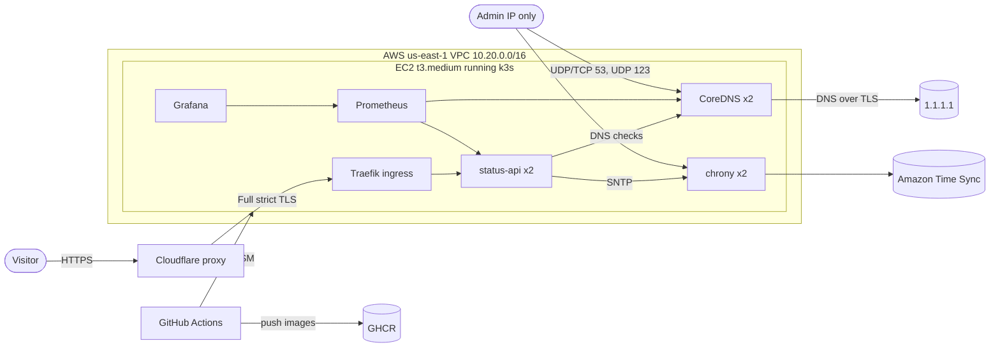

# Cloud Native Platform

A small production style platform that runs **DNS** (CoreDNS) and **time** (chrony NTP) services on Kubernetes in AWS, with a Go status service that checks both and publishes a live status page at **status.ekeneeche.com**.

Everything is code: Terraform builds the AWS side, Ansible configures the node, Kustomize describes what runs in the cluster, and GitHub Actions tests, builds and deploys every change to `main` with no stored AWS keys.

## What it shows

| Area | How |
|---|---|
| Infrastructure as code | Terraform for VPC, EC2, IAM, alarms, OIDC deploy role; imports the hand built portfolio bucket |
| Configuration management | Ansible roles for OS hardening, k3s install and first deploy |
| Containers | Multi stage Dockerfiles, distroless non root runtime image |
| Kubernetes | k3s, Deployments with PodDisruptionBudgets, probes, NetworkPolicies, Pod Security Standards |
| Networking | Authoritative internal zone plus caching recursive resolver over DNS over TLS; NTP server with rate limiting |
| Go | Status API with a hand written SNTP client, DNS checks against a specific server, Prometheus metrics, tests with fake DNS and NTP servers |
| CI/CD | Go, Terraform, Kubernetes, Ansible and security checks on every PR; image build, scan and SSM rollout on `main` |
| Observability | Prometheus alert rules, Grafana dashboard, runbook for every alert |
| Reliability | Rolling updates with zero unavailable, PDBs, EC2 auto recovery, scripted failover drill |
| Security | IMDSv2, encrypted volumes, least privilege IAM, no open resolver, audit logging, flow logs |

## Architecture



More detail in [docs/architecture.md](docs/architecture.md).

## Layout

```
cloud-native-platform/
  services/
    status-api/   Go service and statusctl CLI
    dns/          Corefile and internal zone
    ntp/          chrony config and image
  infra/
    terraform/    AWS infrastructure (bootstrap/ creates the state bucket)
    ansible/      Node configuration
  k8s/            Kubernetes manifests
  .github/workflows/  CI and deploy pipelines
  kustomization.yaml
  docker-compose.yml   Local dev stack
  scripts/        Smoke test, failover drill, local run
  docs/           Architecture, setup, runbook, security
```

## Run it locally

```bash
docker compose up --build
dig @127.0.0.1 -p 1053 status.platform.internal
open http://localhost:8080
```

## Deploy to AWS

See [docs/setup.md](docs/setup.md). Short version: bootstrap the state bucket, `terraform apply`, point `status.ekeneeche.com` at the Elastic IP in Cloudflare, set two repo variables, push to `main`, then run Ansible once.

## Cost

About $1 a day while the t3.medium is running. Spin it up for demos and run `terraform destroy` afterwards; the state bucket and portfolio site stay.

## Status

In progress. Core services, infrastructure and pipeline are written; the AWS deployment and failover drill results are next.
